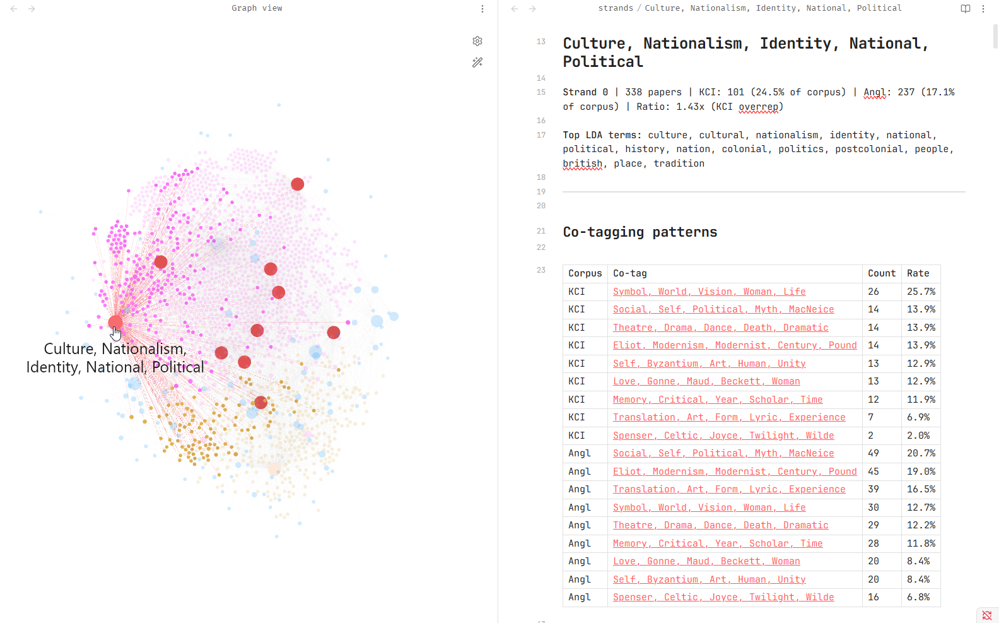
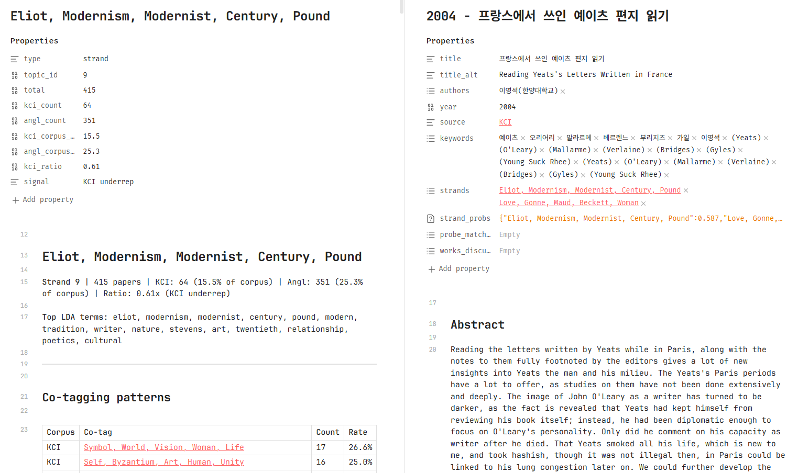
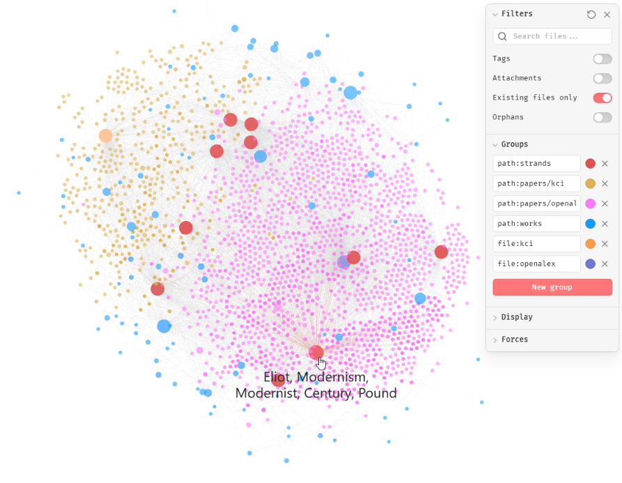

### overview
---

This project is a demonstration of a computational methodological pipeline which aggregates research abstracts from two different research corpora (in this case, KCI-indexed journal publications vs. OpenAlex-indexed English-language journal publications) and utilizes LDA topic modelling in order to identify potential gaps in research disposition. This repository also serves as an appendix and data package for the methodological dimension of our paper, "(Dis)intermediation and its (Dis)advantages," currently undergoing peer review.

The aim of the project is to create a research environment that allows us to, then, close-read the quantitative substance of these gaps to review what is, and isn't, being discussed by scholars within and across these research corpora.

The process, as documented in the demonstration below, should be reproducible with any search term through the following steps:

---

 Step 0: In [Releases](https://github.com/belowelo/yeats/releases), download the latest release and unzip the contents into a new folder.
 
 Step 1: Download [Obsidian](https://obsidian.md/) and [Python 3](https://www.python.org/downloads/)

 Step 2: In the /scripts directory, edit "config.yaml" (set: 'subject,' 'subject_terms', and 'search_terms'), then "works.csv" (and run "works_convert.py" afterwards). The remaining word lists — "stopwords.txt", "false-positives.txt" and "vocabulary-probes.txt" — are prompted for during the run.

 Step 3: Apply for a [KCI API key](https://www.kci.go.kr/kciportal/po/openapi/openApiKeyRequest.kci), fetch the [OpenAlex API key](https://openalex.org/settings/api-key) from your account. Alternatively, utilize the Excel (.xls) data package download from KCI's search engine, and select every parameter.

 Step 4: open "run.bat"
 
 Step 5: In Obsidian, open the entire folder "as a vault" in Obsidian, and press *Ctrl+G* for graph view. 

Note that this process is liable to produce slight differences from the figures published in our paper, as new articles are indexed over time. We've included a sample of our own dataset with which one should reproduce the same figures.

### methodology
---

LDA (latent Dirichlet allocation) is a statistical model that identifies 'topics' from probability distributions within a given text sample's vocabulary.

The research pipeline identifies 10 distinct 'topics' across the sum of every abstract within the dataset, in the form of a list of words that tend to appear together in 'clusters'. Each paper abstract receives, in turn, a label for all the topic(s) to which it substantially contributed (above a given threshold).

Following LDA, the research pipeline also includes a 'vocabulary probe' stage, which allows the researcher to count the occurrence of a given set of words across each corpus and topic (through a simple substring-matching search), to answer any questions about divergent vocabulary use between corpora that may emerge while reviewing the results of the LDA.

### why LDA? 
---

LDA was selected over other topic models for the purposes of this project for its portability and accessibility (anyone should be able to reproduce the process on any machine). More advanced topic models which utilize neural learning (for example, BERTopic) may be more robust, but often at the cost of rendering the methodology inaccessible and opaque. The straightforwardly computational nature of LDA is much easier to audit by-hand for the purposes of qualitative review.

Given our objective was to try and de-contextualize the research material to see what kinds of bias independently surface in each corpus by subject matter, more inferences, especially complex ones, made by the model are not helpful, especially if we were conducting them through neural learning models which may demonstrate bias towards intrinsic syntactic tendencies that have little to do with the content. For example, if a neural network caught onto some indicator of nationality unbeknownst to us, it would actively muddle our findings by virtue of reintroducing the context we stripped from the material on purpose.

### Output Format
---

Obsidian is a free note-taking software with built-in cross-linking capability (like the links in Wikipedia to other Wikipedia articles) between notes within the database, or "vault."

The research pipeline creates an Obsidian vault that contains every abstract as its own document, as well as quantitative analysis documents for each LDA topic strand.

The analysis documents for each topic strand contains:

1. an overview of how much of each corpus (in percentages) is represented in the topic strand;
2. an overview of topic strand overlap, by corpus;
3. the results of the user-assigned vocabulary probe;
4. all the abstracts tagged with the topic strand, organized chronologically and by corpus.

Obsidian also natively handles data-visualization of these interlinked documents in the form of a node-graph (as illustrated below.)

Each note (in our case, a document) is a circle (node), which connects to other circles via a line if it contains a link to it. A given node grows larger if more nodes connect to it, and each connection has a gravitational 'pull,' which allows us to visualize, for example, which 'topic strands' (red) are more often mentioned within the KCI corpus data (yellow) vs. the Anglophone corpus (pink) by virtue of asking "which red circle (topic) is closer to all the yellow (KCI abstracts) and further from all the (pink) (OpenAlex abstracts)?"
### Data Processing
---

- Article Collection

It was a task in and of itself to define, let alone completely and cleanly parse out, the scope of which kinds of 'non-KCI' research we would like to collate. 

For simplicity of LDA topic modelling, the pipeline is currently configured to parse out non-English research languages, but does not disregard English-language abstracts from publications with non-English names or research originating from otherwise non-anglophone countries. 1,846 records from the initial abstract were discarded as the result of not having an English-language abstract.  

The OpenAlex corpus collated not only journal articles, but was inclusive of scholarship of several different types (book chapters, dissertations), whose ‘abstract’ field contains summaries. We deliberated whether to retain or discard this material in topic generation, but chose to retain them: these sources remain significant and relevant enough for a topic generation model agnostic to syntax to determine how a given research community discusses Yeats.

We also disposed of duplicate entries of KCI-indexed articles also indexed in the OpenAlex corpus, leading to a final count of 698 articles indexed by the KCI, and 1,507 articles from the body of Anglophone research published abroad. Given the obvious quantitative bias between the indexed corpora, all relevant metrics pertaining to research corpora will be reported by scale and ratio. While this means that the Anglophone corpus is liable to more heavily influence the identification of certain topics, we determined this was an accurate and meaningful vantage point for observing the smaller corpus’ interactions and engagement with the broader statistical mainstream, and favourable to artificially manipulating or paring down the larger corpus. 

- Data Preparation

In preparing our abstract data for LDA, we conducted a cleanup process including but not limited to:

The elimination of indexing-related artifacts, and prevented the model from indexing several ubiquitous terms which may affect the composition of the topics, such as ‘Yeats,’ ‘W. B.,’ ‘poem,’ ‘poetry,’ ‘irish,’ etc. Decisions here scaled from arbitrary to deliberate. In the case of ‘irish,’ for example, which is often used to introduce the author (“the Irish-born author W.B. Yeats”), it was determined that any significant discussion of irish ‘nationalism’ or the ‘Celtic Twilight’ would surface through those terms.

The elimination of false positives (for example, W.B. Yeats vs. the YEATS protein domain in biology). Our 'false-positives.txt' includes any negative search terms that might assist in removing false positives from data harvestation, although this has proven not to be 100% effective. We were liable to find one or two extraneous abstracts across the topic pages upon every iteration, and endeavoured to configure the false-positives list to remove as many of these as we could find. 

### Validation
---

We found that topic amounts at k=8 or below, while scoring higher in terms of coherence, are liable to flatten two clearly distinct topics into one, in spite of the abstracts dealing with clearly different topics (‘maude gonne,’ ‘byzantium,’ and ‘symbol’), and differently. at k=10, the topic identifies Yeats’ romantic life and his symbolic system clearly separate. 

The **fit** of a given run of LDA measures the run's success. A fit's perplexity indicates the rate at which the topics can be inversely uitilized to predict the contents of the input data. Convergence is the numbers of iterations which were necessary until the LDA arrived at a reasonable "conclusion."  

Fit: k = 10 · seed 5 · perplexity 2696.96 · converged at 289 of a 500 iteration ceiling · 2,211 documents · 5,092 vocabulary · 0.2 tagging threshold. 

**Coherence** is a validation metric which measures how often the words (configured here to n=15 words) in the topics identified by the LDA actually co-occur amongst the data provided. A positive NPMI equals more likely than anticipated, while a negative NPMI equals less likely than anticipated. Note that in a project like ours, which utilizes a dataset comprised of two distinct sources, a negative NPMI might not necessarily be indicative of complete incoherence, but that the association between certain words within a given topic may be weaker than sets of others. 

| topic | top words                                                     | C_v   | NPMI   |
| ----- | ------------------------------------------------------------- | ----- | ------ |
| 0     | political, culture, nationalism, identity, cultural, national | 0.719 | +0.128 |
| 1     | life, swan, child, leda, old, line                            | 0.354 | −0.041 |
| 2     | love, woman, gonne, maud, easter, beauty                      | 0.509 | −0.019 |
| 3     | eliot, pound, stevens, modernist, writing, ezra               | 0.437 | −0.012 |
| 4     | art, joyce, theatre, dublin, beckett, abbey                   | 0.509 | +0.014 |
| 5     | drama, form, century, theatre, modernism, dramatic            | 0.405 | +0.013 |
| 6     | translation, language, writer, time, narrative, writing       | 0.427 | +0.011 |
| 7     | english, modern, year, macneice, auden, century               | 0.370 | −0.026 |
| 8     | art, vision, philosophy, influence, idea, modernism           | 0.459 | +0.022 |
| 9     | world, life, self, human, death, symbol                       | 0.614 | +0.077 |
| mean  |                                                               | 0.480 | +0.017 |

### disclosure + transparency
---

This research complies with the NRF (한국연구재단)'s guidelines on generative AI use. 

- Python scripts were developed with the assistance of an LLM (Claude Opus 4.7 and 5 through Claude Code, Anthropic), which wrote the code in standard Python and assisted in testing and debugging. The Python libraries utilized are open-source (BSD license). The implementation, and the exact build of machine-written code used to execute the computational analyses described throughout the paper, can be found in full on our GitHub repository, as well as a log of user prompts utilized in the writing and debugging process.

- The computational classification and distant-reading analysis of abstracts was entirely conducted through LDA and substring matching against a curated list of terms. At runtime, this process does not utilize neural network or LLM technology whatsoever. Qualitative analysis and review of abstract data and their classification were conducted entirely by the researchers themselves over a course of several weeks.

- The qualitative analysis of the resultant abstracts and topics, as published in our paper, were conducted entirely by the researchers. Code generation and design through LLMs is software industry standard: text and qualitative analysis generation for academia is not.

- A partial transcript of the LLM prompts utilized to spec, write, and edit the code is available in transcripts.md. As we utilized a version of Claude Code which runs locally on the researchers' machines, the conversations are not accessible in the form of an online conversation log. We have opted to publish a collection of partially redacted and edited partial transcripts to indicate the scope of the technology's use, as the LLM conversation was conducted in conjunction with adjacent projects and alongside minor and unrelated personal use.

---

