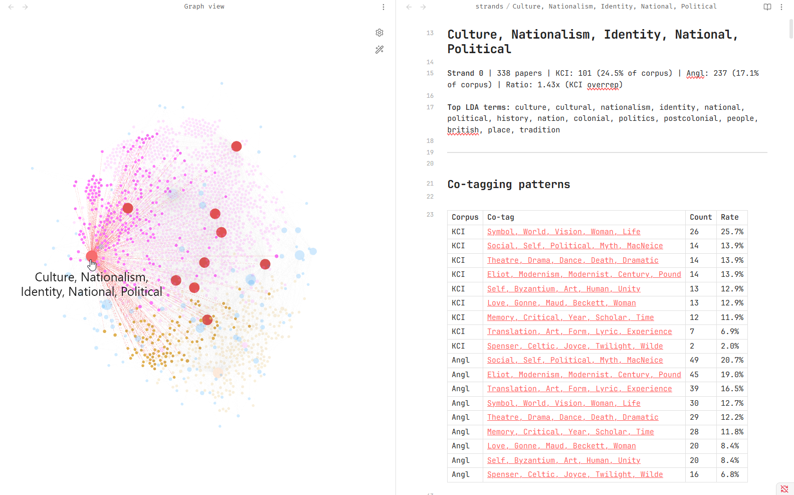
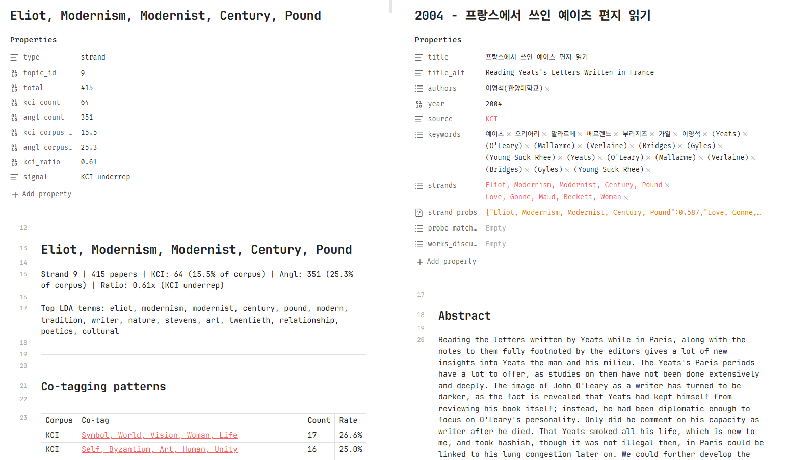
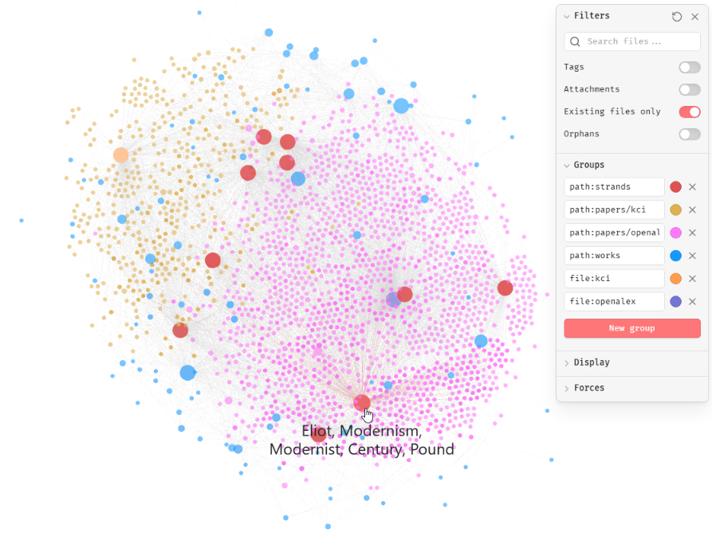

## comparative computational metaanalysis
### demo: the comparative yeats - KCI vs. OpenAlex

> 우리나라에서 예이츠 연구의 활성화를 기하기 위해서는 다른 학자들의 논문을 꼼꼼하게 읽어보고 반박할 것은 반박하고 격려할 것은 격려해야한다고 생각된다. 서로의 연구성과를 비판적인 시각으로 평가하고 이를 자신의 논문에 반영할 때, 서로의 학문적 발전이 있을 수 있다. 한국예이츠저널 에 수록된 논문 중에서 점차 많은 논문들이 우리나라에서 우리나라 학자들이 연구한 결과를 인용하고 있지만, 보다 더 많은 인용이 있어야할 것으로 생각된다. 보다 많은 국내의 연구성과를 검토하고 이를 바탕으로 자신의 연구를 심화시켜 나갈 때 우리나라에서 행해지는 예이츠의 연구가 세계적인 성과를 낼 수 있으리라고 믿는다.

최희섭, 한국예이츠저널 수록논문의 국내문헌 인용 고찰, 2006

### overview
---

This project is a demonstration of a computational methodological pipeline which aggregates research abstracts from two different research corpora (in this case, KCI-indexed journal publications vs. OpenAlex-indexed English-language journal publications) and utilizes LDA topic modelling in order to identify potential gaps in research disposition. 

The aim of the project is to create a research environment that allows us to, then, close-read the quantitative substance of these gaps to review what is, and isn't, being discussed by scholars within and across these research corpora. 

The process, as documented in the demonstration below, should be reproducible with any search term through the following steps:

- **Step 0:** In [Releases], download the latest release and unzip the contents into a new folder.

- **Step 1:** Download [Obsidian]()

- **Step 2:** Apply for a [KCI API key](https://www.kci.go.kr/kciportal/po/openapi/openApiKeyRequest.kci), then copy-paste it into the ".env" in /scripts using a text editor

- **Step 3:** In the /data directory, edit "config.yaml", "works.csv", and "stopwords.txt"

- (Optional) if you anticipate that your search terminology will flag false positives, configure "false-positives.txt" 

- **Step 4:** open "run.bat"

- Step 5: open the entire folder "as a vault" in Obsidian, and press `Ctrl + G` for graph view.

### related research
---

Joo Meeran has previously conducted a computational study on research trends in Yeats scholarship in the KCI index utilizing TEXTOM and UCINET to analyze title data. This research project attempts to conduct a follow-up comparative study between the KCI and international OpenAlex indices utilizing LDA topic modelling, identifying and evaluating divergent research dispositions within the two domains and close-reading sample data to qualitatively verify the veracity of the results. 

This study is a qualitative complication of existing quantitative and comparison research being done in bibliometry ([Yang, Kiduk, et al.](https://accesson.kr/jistap/v.9/3/76/9990) conducted a study of citation gaps between KCI and International publications in Information Science). 

### methodology
---

- Corpus Selection

The research pipeline collates search-term result data in the form of titles, abstracts, publications, and author names from OpenAlex (a public-access research database without institutional access requirements) and KCI's Open API protocol, and processes this data into a navigable Obsidian vault.

The research motive has two internal limitations that we weren't able to completely overcome, but should be negligible for most usecases. 

The first is the infeasibility of defining, let alone completely parsing out the scope of which kinds of 'non-KCI' research we would like to collate. For simplicity of LDA topic modeling, the pipeline is currently configured to parse out non-English research languages.

The second is the potential abundance of false positives within a given research domain (for example, W.B. Yeats vs. the YEATS protein domain in biology). A false-positives.txt is included to identify any negative search terms that might assist in removing false positives from data harvestation, although this has proven not to be 100% effective.

-  Topic Modelling + Multi-Tagging + Vocabulary Probing

LDA (latent Dirichlet allocation) is a statistical model that identifies 'topics' from probability distributions within a given text sample's vocabulary. 

The research pipeline identifies 10 distinct 'topics' across the sum of every abstract within the dataset, in the form of a list of words that tend to appear together in 'clusters'. Each paper abstract receives, in turn, a label for all the topic(s) to which it substantially contributed (above a given threshold).  

LDA was selected over other topic models for the purposes of this project for its portability and accessibility (anyone should be able to reproduce the process on any machine). More advanced topic models which utilize neural learning (for example, BERTopic) may be more robust, but often at the cost of rendering the methodology inaccessible and opaque. The straightforwardly computational nature of LDA is much easier to audit by-hand for the purposes of qualitative review. (See more in the disclosure section below.)

Following LDA, the research pipeline also includes a 'vocabulary probe' stage, which allows the researcher to count the occurrence of a given set of words across each corpus and topic (through a simple substring-matching search), to answer any questions about divergent vocabulary use between corpora that may emerge while reviewing the results of the LDA. 

- Output Format

Obsidian is a free note-taking software with built-in cross-linking capability (like the links in Wikipedia to other Wikipedia articles) between notes within the database, or "vault."

The research pipeline creates an Obsidian vault that contains every abstract as its own document, as well as quantitative analysis documents for each LDA topic strand.

The analysis documents for each topic strand contains: 

1) an overview of how much of each corpus (in percentages) is represented in the topic strand;
2) an overview of topic strand overlap, by corpus;
3) the results of the user-assigned vocabulary probe;
4) all the abstracts tagged with the topic strand, organized chronologically and by corpus.
   

Obsidian also natively handles data-visualization of these interlinked documents in the form of a node-graph (as illustrated below.) 

Each note (in our case, a document) is a circle (node), which connects to other circles via a line if it contains a link to it. A given node grows larger if more nodes connect to it, and each connection has a gravitational 'pull,' which allows us to visualize, for example, which 'topic strands' (red) are more often mentioned within the KCI corpus data (yellow) vs. the Anglophone corpus (purple) by virtue of asking "which red circle (topic) is closer to all the yellow (KCI abstracts) and further from all the purple (OpenAlex abstracts)?"

 - Sample Size
 
	Given potential disparities in data quantities between topics, the pipeline defaults to proportional analysis rather than limiting the dataset to a finite sample size. The abstracts collated are from 1990-present day, as the KCI database runs extremely thin before that period of time. 

### demo scope + hypothesis
---

Scholarship concerning W.B. Yeats was collated from each research corpus as part of the demonstration. 

Yeats is, arguably, amongst the most well-read modernist authors amongst Korean English literature scholars, with a relatively robust translation history, contemporaneous to his time of writing. This translation effort was so enabled by some of the prolific notable literary minds of his Korean contemporaries such as Kim Ok, who resonated greatly with the imagery and messaging of his work. 

In the Anglophone field, the effort of New Modernist Scholars to orient the discipline away from the Eurocentric concept of a singular 'Modernism' into a more decentralized and intercultural understanding of many 'Modernisms,' has perhaps also caused Yeats to occupy an interesting place in the scholarship.

Although he was a staunch anticolonial Nationalist in his youth, his later bent towards authoritarianism and eugenics has always made him somewhat of a contentious figure amongst Anglophone scholars, to the point that scholars deem a disclaimer of the following calibre necessary when reading him with a critical bent:

> Due to Yeats's anti-democratic and elitist remarks and his problematic responses to authoritarian political performance in Europe and Ireland, his **theatre is often seen as a space which fosters exclusion, conventional notions of heroism, and sexual polarization**. Even though the authoritarian and elitist aspects of Yeats's life and work cannot be denied, his rich queer and feminist networks...

Balázs, "Yeats's Queer Dramaturgies: Oscar Wilde, Narcissus, and Melancholy Masculinities in *Calvary*" (2020)

(As one may be able to construe from Balázs's abstract, the Anglophone corpus is comparatively underrepresented in the LDA topic strand that encompasses the domain of Theater, whereas the KCI corpus is significantly over-represented.)

For the KCI corpus, discussion of his later-life fascist bent has seemed, contrary to the anglophone world of Yeats studies, visibly scarce. As Yeats (or the translation of Yeats and his imagery and form) is a significant and influential figure in the history of Korea's *own* postcolonial Modernism, this is an interesting and nonarbitrary divergence in research and pedagogy.

Yeats was therefore selected as the demonstrative use-case of the study, as this divergence, if quantifiable, will be clearly and strictly visible in not only the dataset in a way that tangibly reflects in conference proceedings and university classrooms of each research locale.

### preliminary findings
---
*findings are cursory: these were a lot (1711~) of abstracts to read*
#### topic strands: symbolism vs. historicism

| Label | Topic Strand                   | % of KCI | % of OA | Ratio |     |
| ----- | ------------------------------ | -------- | ------- | ----- | --- |
| 6     | Symbol, World, Vision          | 42.1%    | 15.9%   | 2.65x | KCI |
| 3     | Self, Byzantium, Art           | 28.6%    | 14.6%   | 1.96x | KCI |
| 0     | Culture, Nationalism, Identity | 24.5%    | 17.1%   | 1.43x | KCI |
| 8     | Theatre, Drama, Dance          | 24.0%    | 18.4%   | 1.30x | KCI |
| 7     | Love, Gonne, Maud              | 12.8%    | 16.9%   | 0.76x | OA  |
| 5     | Social, Self, Political        | 12.6%    | 19.2%   | 0.66x | OA  |
| 9     | Eliot, Modernism, Modernist    | 15.5%    | 25.3%   | 0.61x | OA  |
| 1     | Memory, Critical, Year         | 14.3%    | 23.8%   | 0.60x | OA  |
| 2     | Spenser, Celtic, Joyce         | 5.6%     | 9.4%    | 0.60x | OA  |
| 4     | Translation, Art, Form         | 10.4%    | 21.2%   | 0.49x | OA  |

Topic Distributions of Yeats Studies, KCI and OpenAlex (Anglophone)
(Some papers were identified as contributing significantly to two or more topics.)

Immediately identifiable in the results of the topic model is the stark predominance of KCI abstracts that routed their reading through the 'Symbol' topic (topic 6). 

A verificatory reading of the abstracts collated under the category affirmed that the bulk of the work identified as belonging to the category demonstrated an interest in methodologies that might be described as 'semiotics' or 'exegesis,' which utilize Yeats's metaphysical treatise "A Vision" and related poetic works "Sailing to Byzantium," "Byzantium" as symbolic and philosophical centrepieces. 

A glance at the Anglophone corpus, on the other hand, revealed a much-deeper taxonomical interest in Yeats and his work as historical figure (whether it be formal or rote history), interest in reading him as a contemporary to T.S. Eliot and Ezra Pound (as identified in topic 9) and an aesthete of interest in European Modernism, as well as a key figure in anticolonial history of Ireland, positioning his Celtic Twilight against Edmund Spenser's "A View of the Present State of Ireland."

What's apparent from the collated abstracts is that the divergence of scholarly interest in these different aspects of Yeats is not necessarily a gap or difference in critical interest (post-colonial theorists such as Said and Spivak appear quite frequently in both corpora, and there is an equal verve of interest in gender studies), but more evidently a difference in methodological bent and observational standpoint. Literary studies, in the US especially but less so elsewhere, had seemed to pivot greatly towards "New Historicism" during the 1990s (the earliest cut-off date for this study) following the work of Stephen Greenblatt in the 80s, decentring formalist close-reading, including the Semiotics system of Barthes and Saussure, as the predominant mode. 

This distinction is significant and immediately apparent, but indeed not monolithic. In a study titled "Important Nonsense: Yeats and Symbolism," published 2019 in Hopkins Press' *New Literary History*, David Dwan directly acknowledges and articulates that he is writing against the grain of his own research corpus's New Historical bent:

> I hope to recover some of the intellectual excitement of symbolism both as a practice and as a theory and to show how this excitement is lost when the study of literary form is removed from a broader philosophical history-the metaphysical character of which many scholars might feel they have outgrown.

Another divergence in the KCI's Semiotic bent and the heavily U.S.-influenced New Historicist bent of the OpenAlex corpus is in the perception of Yeats as a political and national figure.

Symbolist scholarship, especially of texts like "A Vision" which construct a coherent personal-philosophical esoterism of signs, eagerly philosophize the *poet*'s interiority and personhood in its study. 

One may imagine, on the other hand, scholars with New Historicist education finding any further sophistication of his interiority beyond how it affects his material actions and his networked relationship with contemporary thinkers quite unwieldy and inconsequential as materials for study.

This divide is most evident in the visible Anglophone-KCI split amongst abstracts identified as belonging to topic 0 (Culture, Nationalism, Identity), and serves as a strong justification for allowing LDA to identify a given abstract as belonging simultaneously to any topic above a probability threshold of (>20%) rather than the single most prominent one. 

| Co-tag                                  | ratio | KCI   | OA    | lean |
| --------------------------------------- | ----- | ----- | ----- | ---- |
| Social, Self, Political                 | 18.6% | 13.9% | 20.7% | OA   |
| Eliot, Modernism, Modernist             | 17.5% | 13.9% | 19.0% | OA   |
| Symbol, World, Vision                   | 16.6% | 25.7% | 12.7% | KCI  |
| Translation, Art, Form                  | 13.6% | 6.9%  | 16.5% | OA   |
| Theatre, Drama, Dance                   | 12.7% | 13.9% | 12.2% | -    |
| Memory, Critical, Year                  | 11.8% | 11.9% | 11.8% | -    |
| Self, Byzantium, Art, Human, Unity      | 9.8%  | 12.9% | 8.4%  | KCI  |
| Love, Gonne, Maud, Beckett, Woman       | 9.8%  | 12.9% | 8.4%  | KCI  |
| Spenser, Celtic, Joyce, Twilight, Wilde | 5.3%  | 2.0%  | 6.8%  | OA   |

The Anglophone corpus discusses, visibly, Yeats's relationship to "Culture, Nationalism, Identity" (topic 0) most through his social and political personhood, as well as his historical-social position in the Modernist milieu as an aesthete. The KCI corpus, on the other hand, trends toward identifying his culture and national identity through the framework of his internal, private personhood.

#### vocabulary probes: nationalism and reactionary politics

This distinction manifests most clearly in the discussion of Yeats's later-life turn towards reactionary politics. 

> The question of "Yeats's fascism," however, does not generate the most revealing answers...

*from Marjorie Howes, "The Rule of Kindred: eugenics, Purgatory, and Yeats's race philosophy" (1996)*

As hypothesized, following the evaluation of Yeats as a sympathiser and advocate for fascism and eugenics, it appears to have become somewhat customary for scholars to issue a disclaimer in their abstracts when positioning Yeats' work as critically productive. Stephanie J. Pocock, for the *New Hibernia Review*, argues: 

> ...It is misleading to make him essentially non-political, on the strength of certain disclaimers, refusals, and ironies.

*from "Artistic Liminality, Yeats's Cathleen ni Houlihan and Purgatory."*

Much of the discussion, even advocatory, since O'Brien's study, seems to position Yeats as an author-on-trial, concerning whom the debate centred not whether he was innocent or guilty but the severity of the charge and the defensibility of the crime under colonial duress,  weighed against the persisting value of his work. 

On the other hand, within the KCI corpus, even when it comes to the heavy-handed and explicitly political thematic core of topic 0: "Culture, Nationalism, Identity," explicit and perhaps incendiary verbiage concerning Yeats's political controversy seems strangely absent.

This insularity from the heated discussion of Yeats's political status via physical and editorial distance from the controversy may partially illuminate, beyond the simple difference of methodology, why it may be the case that less scholars in the Anglophone-indexed world are taking on contained and self-sufficient Symbolic and philosophical analyses of Yeats's work in comparison to the KCI corpus. As it stands, for 60 years, discussion of Yeats's poetic dimensionality as self-sufficient form would have seemed to *beg the question* in the Anglosphere.

This disparity in research cadence is illustrated in the data: string-match probes on abstract data across both corpora confirm that the use of explicitly political language leans significantly towards the Anglophone corpus:

|           | KCI   | OA    | gap   |
| --------- | ----- | ----- | ----- |
| politic   | 11.4% | 17.5% | −6.0% |
| reception | 0.2%  | 3.1%  | −2.9% |
| debate    | 1.0%  | 3.0%  | −2.1% |
| fascis    | 0.2%  | 1.7%  | −1.4% |
| eugenic   | 0.7%  | 1.2%  | −0.5% |
| contested | 0.0%  | 0.5%  | −0.5% |

This is not to say that scholars published in the KCI are, by-and-large, unaware of the severity of the accusations levied against Yeats: for scholarship within the thematic strand, it seems quite the opposite. The discussion of Yeats's politics can be easily identified as being conducted instead in the KCI corpus largely through the singular term "conflict," potentially explaining the extant gap of political-leaning langauge. This is validated *strongly* in a the vocabulary probe: 

|          | KCI   | OA   | gap   |
| -------- | ----- | ---- | ----- |
| conflict | 13.6% | 4.5% | +9.1% |

The predominant use of this single word in place of the prosecutorial debate, as is commonplace in Anglophone scholarship, is illustrative: scholarship in the KCI corpus, perhaps somewhat permissively or gently but in full accordance with their methodological lean, positions Yeats as a flawed and ambivalent *person* whose interiority contained deeply disappointing *personal* failures.

This is not to say that KCI researchers are themselves ambivalent or noncritical in the discussion of Yeats's political failures: far from it.

Kim Jooseong, for example, writing for *Yeats Journal of Korea* in 2005, positions himself very specifically within the debate, arguing that the precarious dual identity of Yeats as both a white, reactionary nationalist of the first world and an anti-colonial thinker poses a challenge for identifying him cleanly as a postcolonialist, but that this challenge can indeed be scholarly generative:

> 조국의 독립이후 예이츠의 많은 시에서 우리는 정치적으로 초기시의 파시스트적인 민족중심주의을 상실하고 있음을 볼 수 있다... 그를 진정한 포스트콜로니얼 시인으로 간주하는 데는 몇 가지 문제점이 있다. 먼저 그는 아일랜드의 지정학적 위치나 인종상으로 구분할 때 제3세계출신이 아니다... 포스트콜로니얼적인 특징은 작가들이 형식에 있어 주류의 영어시 형과 전통적인 구전문학 전통을 결합시켜 새로운 형태를 만들어 내려는 시도에서 찾을 수 있다. 이점에서도 예이츠는 아일랜드의 구전문학의 전통에 관심을 갖기는 했지만 그의 관심은 내용에만 머물렀을 뿐 새로운 형태의 작품을 제시하지 못하고 있다. 단지 종전의 예이츠를 민족시인으로만 한정시킨다거나 범 우주적인 철학시인으로 확대한다거나 하는 단순성에서 벗어나 조금은 새로운 관점을 제시하려고 하는 것이다.

*Kim Jooseong, "Postcolonial Approach to Yeats's Poems"*

Kim's thesis presents a reasonable complication and challenge to Edward Said's conception of Yeats as a decolonial poet who failed mid-way in transcending nativist thought into liberatory thought, and a quite more critical one at that, as it identifies his inability to transcend nativism into a 'liberated' state as a *personal* and *artistic* failure. 

Kim's paper, in that it identifies this evident incompatibility between Yeats's political identity and the postcolonial impulse as potentially generative, also predates Marjorie Howes' similar maneuver in 2006 in her book chapter, "Yeats and the Postcolonial," by a year. (This 2006 turn represents a significant change in Howes' own thinking about Yeats's configuration in relation to the postcolonial, as evident in her 1996 essay "The Rule of Kindred" in which she mirrored Said's analysis of Yeats's nativism to illustrate that the concept of nationality poses a challenge for postcolonialism as a whole.): 

> I think this apparent difficulty is a good thing; rather than being an obstacle in the reader’s way, it is precisely what makes it useful to explore the relationship between Yeats’s writings and postcolonial studies. This exploration may raise more questions than it answers, and the reader may find this frustrating, but if she can adjust her expectations, she will also find that there are varieties of uncertainty that are more illuminating, and even more enjoyable, than certainty.

Yet, the corpora's tendency to overtly gloss over the discussion of the very real material harms of Yeats' political ideologies in language in lieu of mentioning them by name remains questionable. The content of Kim's abstract, which is in line with the noncontentious conventional verbiage of the KCI's corpus, reads entirely differently from the substance of the body of the paper:

> For the constituencies of Yeats studies, the claiming Yeats as postcolonial can help renew attention to a poet who, often charged with antifeminism and reactionary politics, has been losing ground to postmodernism, antiformalism, and ethnic writing. Yeats's postcolonization can strengthen the claim of Irish studies to be a player in the vibrant field of postcolonial studies.... If postcoloniality is construed not as after decolonialization but as since colonization, then Yeats is more easily swept whole into the postcolonial canon, but so would be all kinds of Irish literature since the early 20th century, perhaps stretching the term postcolonial beyond use. So, we can have difficulties in defining Yeats as a postcolonial poet.

Throughout the abstract, Kim positions himself as a scholar who may be *defending* Yeats from accusations of reactionary politics, confronted with the definitional challenge of trying to make Yeats legible in the context of postcolonialism given the periodization of British colonialism in Ireland. However, his actual critical analysis is, arguably, conducted through and reliant on the very vectors of Yeats's reactionary politics and his status as a 1st-world author.

This contrast between Kim's abstracted linguistic framing of his research vs. the subject of the paper itself is simultaneously a finding and an obstacle for the computational approach to identifying research dispositions through linguistic patterns.

Joo (2021), in her precedent study of the KCI Yeats research corpora through computational distant reading, only utilized the content of research papers' titles. If the corpora of KCI research fails to confidently flag its own distinct research dispositions in its abstracts or titles, especially in relation to contentious scholarly debates, it seems to place a definitive qualitative limitation to this approach.

However, it is arguably a finding in and of itself that the language with which the KCI corpus communicates its research demonstrates a reliance on evasive and hedged language in the making of these confrontations and contradictions within Yeats's identity, which may read as avoidance or even endorsement. 

### disclosure
---

This research complies with the NRF (한국연구재단)'s guidelines on generative AI use. 

- Python scripts were developed with the assistance of an LLM (Claude, Anthropic), which wrote the code in standard Python and assisted in testing and debugging. The Python libraries utilized are open-source. 

- The research pipeline contains no neural-network technology (semantic embedding technology and large-language models), at runtime, by design. The computational classification and distant-reading analysis of abstracts is entirely conducted through LDA and substring matching against a manually-curated list of terms.

	The ethical reasons behind this decision are twofold: 1) reproducibility and transparency: it is difficult to identify how and why a neural model would've identified a given body of text as matching a given topic, and 2) attribution: semantic embedding models and LLMs are built using web-scraped training corpora, including academic writing whose authors did not provide prior consent. 

- Qualitative analysis of abstracts and topics, following topic modelling and data processing + cleanup, were conducted entirely by the researcher. Code generation and design through LLMs is software industry standard: text and qualitative analysis generation for academia is not.

### citations
---

최희섭, "한국예이츠저널 수록논문의 국내문헌 인용 고찰," *한국예이츠저널 (Yeats Journal of Korea)*, 2006

Balázs, "Yeats's Queer Dramaturgies: Oscar Wilde, Narcissus, and Melancholy Masculinities in Calvary," 2020

Yang, Kiduk, et al., citation gap study, *JISTAP* 9.3

Dwan, David, "Important Nonsense: Yeats and Symbolism," *New Literary History*, 2019

Howes, Marjorie, "The Rule of Kindred: Eugenics, Purgatory, and Yeats's Race Philosophy," 1996

Pocock, Stephanie J., "Artistic Liminality, Yeats's Cathleen ni Houlihan and Purgatory," *New Hibernia Review*

O'Brien, Conor Cruise, "Passion and Cunning: An Essay on the Politics of W. B. Yeats," 1965

김주성, "Postcolonial Approach to Yeats's Poems," *한국예이츠저널 (Yeats Journal of Korea)*, 2005

Howes, Marjorie, "Yeats and the Postcolonial," 2006

주미란, computational study of KCI Yeats research corpora, *한국예이츠저널 (Yeats Journal of Korea)*, 2021
